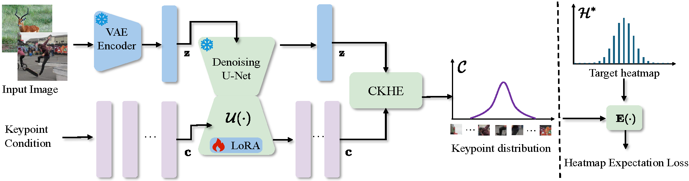

# GenLoc

Official implementation of the CVPR 2025 paper: **"[Generalizable Object Keypoint Localization from Generative Priors](https://openaccess.thecvf.com/content/CVPR2025/html/Wang_Generalizable_Object_Keypoint_Localization_from_Generative_Priors_CVPR_2025_paper.html)"**.



## Installation

### 1. Clone code
```shell
    git clone https://github.com/kennethwdk/GenLoc
    cd ./GenLoc
```
### 2. Create environment for this repo
```shell
    pytorch==2.5.1
    transformers==4.48.1
    diffusers==0.32.2
    accelerate==1.3.0
    numpy==1.26.4
    xtcocotools==1.14.3
```

### 5. Prepare dataset
Download [AP-10K](https://github.com/AlexTheBad/AP-10K) from website and put the zip file under the directory following below structure.

```
./data
|── ap-10k
│   └── annotations
|   └── data
```
## Usage

### 1. Train Model

```shell
    CUDA_VISIBLE_DEVICES=0,1 python train.py
```

### 2. Evaluate Model

```shell
    python valid.py
```


## Citations
If you find this code useful for your research, please cite our paper:

```
@inproceedings{Wang_2025_CVPR,
    author    = {Wang, Dongkai and Duan, Jiang and Wen, Liangjian and Xuan, Shiyu and Chen, Hao and Zhang, Shiliang},
    title     = {Generalizable Object Keypoint Localization from Generative Priors},
    booktitle = {Proceedings of the IEEE/CVF Conference on Computer Vision and Pattern Recognition (CVPR)},
    month     = {June},
    year      = {2025},
    pages     = {20265-20274}
}
```

## Acknowledgement
The code is mainly encouraged by [StableKeypoints](https://github.com/ubc-vision/StableKeypoints). We thank the authors for their contributions to the community!